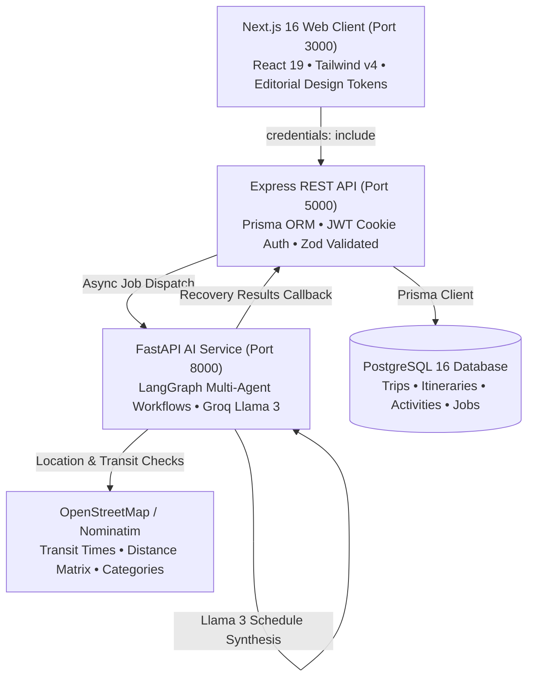

# 🧭 Trip Genie — Autonomous Travel Operations & Disruption Recovery Atelier

> **Bespoke journeys that adapt when the unexpected strikes.**  
> An autonomous travel platform pairing AI generation with real-time operational sensing, multi-option schedule recovery, and human-in-the-loop approval.

---

## 🏛️ System Architecture



---

## ⚡ Flagship Feature: The Travel-Ops Disruption Recovery Loop

Most travel applications produce static markdown checklists that break the moment real life happens. **Trip Genie** is an operational travel engine:

1. **Incident Sensing:** When flight delays (+4h), sudden rainstorms, or museum closures strike, affected itinerary segments are flagged in real-time.
2. **Autonomous Multi-Option Synthesis:** An autonomous LangGraph agent resolves transit constraints, opening hours, and traveler pace to generate 2–3 optimal recovery paths.
3. **Executive Visual Diffing:** Side-by-side proposal comparison with semantic color-coded tags:
   - 🟢 **Added Activity** (Indoor museums, sheltered cultural venues)
   - 🔴 **Cancelled Activity** (Rain-conflicted outdoor walking tours)
   - 🟡 **Shifted Timing** (Rescheduled reservations, e.g. `Moved +1h 30m`)
   - 💵 **Financial Impact Pill** (`+$35.00` or `-$15.00`)
4. **Human-in-the-Loop Approval:** No unexpected changes occur without traveler consent. Approving a proposal activates a new version, refreshes the timeline with optimistic UI, and logs an immutable audit trail with **1-click rollback**.

---

## 🎨 Design Philosophy: "The Modern Concierge & Editorial Atelier"

Trip Genie deliberately rejects the generic "AI vibe code" look (no dark purple/cyan glowing cards, no neon flares, and no sterile hospital-white SaaS templates). 

- **Canvas & Paper Depth:** Warm Alabaster (`#FBFBF9`) canvas paired with crisp warm white cards (`#FFFFFF`) and hairline stone dividers (`#E2DFD6`).
- **Heritage Branding:** Deep Alpine Pine (`#17382B`) and Spiced Terracotta (`#B85D38`) accents reminiscent of *Monocle Travel, Condé Nast Traveler, and vintage Swiss rail manifests*.
- **Typography Pairing:** Editorial display serif (`Newsreader`) for headlines and trip titles, paired with precision interface grotesque (`Geist Sans`) and tabular monospace (`Geist Mono`) for 24h timestamps and currencies.
- **Tactile Micro-Interactions:** Subtle physical spring compression on button press (`active:scale-[0.98]`), smooth layout transitions, and frosted modal backdrops.

---

## 🚀 Quickstart & Local Setup

### Option 1: Single-Command Docker Compose (Recommended)

Run all 4 services (PostgreSQL, Express API, FastAPI AI service, Next.js Web) with one command:

```bash
docker compose up --build
```

- **Web Frontend:** [http://localhost:3000](http://localhost:3000)
- **Express API:** [http://localhost:5000](http://localhost:5000)
- **FastAPI AI Service:** [http://localhost:8000](http://localhost:8000)
- **API Health Check:** [http://localhost:5000/api/users/me](http://localhost:5000/api/users/me)

---

### Option 2: Running Services Locally

#### 1. Express Backend
```bash
cd apps/api
npm install
npx prisma generate
npx prisma db push
npm run seed     # Populates demo traveler & 3-day Tokyo trip
npm run dev      # Runs on port 5000
```

#### 2. Python AI Service
```bash
cd apps/ai-service
python -m venv .venv
source .venv/bin/activate  # On Windows: .venv\Scripts\activate
pip install -r requirements.txt
uvicorn app.main:app --reload --port 8000
```

#### 3. Next.js Frontend
```bash
cd apps/web
npm install
npm run dev      # Runs on port 3000 with Turbopack
```

---

## 🎬 60-Second Interview Walkthrough & Demo Guide

To demonstrate the full Travel-Ops loop during an interview:

1. **Sign In:** Go to [http://localhost:3000/login](http://localhost:3000/login).
   - Click the seeded demo credentials badge: `traveler@tripgenie.com` / `Password123!`.
2. **Explore Dashboard:** Observe the warm atelier layout, trip status tabs (`Active`, `Drafts`, `Completed`), and the **Tokyo Autumn Odyssey** expedition card.
3. **Inspect 24h Timeline:** Click into the trip to view the Day Selector tabs, continuous 24h chronological rail, boarding-pass activity cards, and drag/arrow reordering.
4. **Trigger Disruption:** Click **"Simulate Disruption"** in the header. Select 🌩️ **"Heavy Rainstorm on Day 2"**.
5. **Inspect Recovery Diff:** Observe the LangGraph recovery output side-by-side:
   - 🔴 Senso-ji Walking Tour cancelled
   - 🟢 Mori Art Museum added
   - 🟡 Omakase dinner shifted to 20:30
   - 💵 Net financial savings: `-$15.00`
6. **Approve Version:** Click **"Approve & Activate Version 2"** in the modal.
7. **Verify Audit Trail:** Observe the immutable event ledger tracking AI actions and human approvals, then test the 1-click **"Rollback to Version 1"** button.

---

## 📁 Repository Structure

```
trip-genie/
├── apps/
│   ├── api/             # Express.js REST API + Prisma ORM + JWT Auth
│   │   ├── prisma/      # Schema, migrations, and realistic Tokyo seed script
│   │   └── src/modules/ # auth, trips, itineraries, itinerary-days, activities, places, jobs
│   ├── ai-service/      # Python FastAPI + LangGraph + Groq Llama 3
│   │   └── app/         # Generation workflows, disruption recovery, OSM transit tools
│   └── web/             # Next.js 16 (App Router) + React 19 + Tailwind v4
│       ├── src/app/     # (auth), (dashboard), /trips/[tripId], /disruptions
│       ├── src/features # itinerary, simulator, recovery, approvals, audit, generation
│       ├── src/lib/api  # Typed API client with credentials: "include"
│       └── src/styles/  # Design tokens & CSS variables in globals.css
├── docker-compose.yml   # Multi-container orchestration
├── FRONTEND_SPEC.md     # Single source of truth design & architecture specification
└── README.md            # Master portfolio documentation
```

---

## 📄 License
MIT © Trip Genie Atelier
